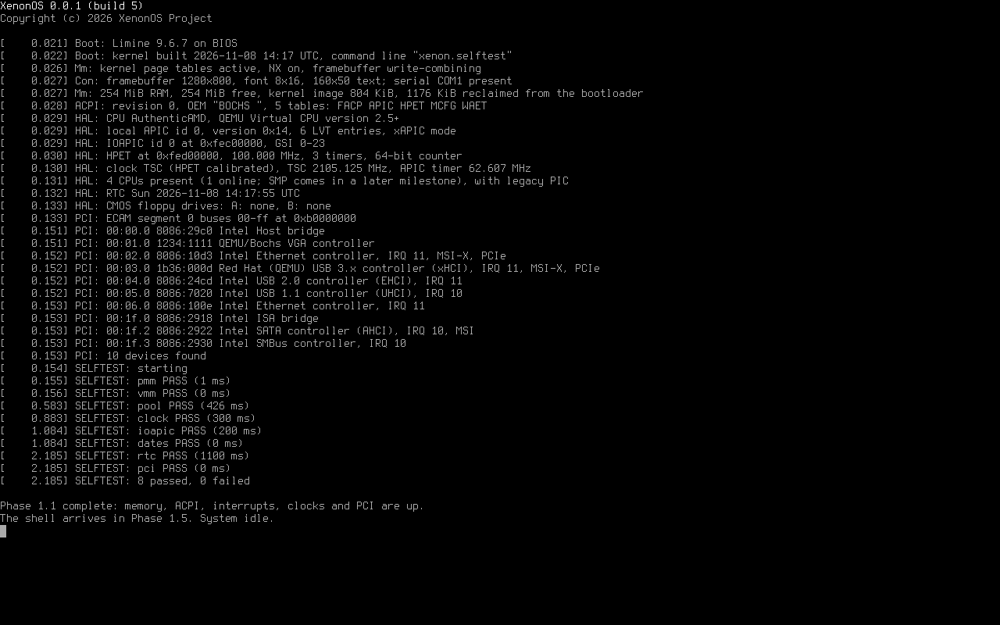

# XenonOS

A from-scratch x86-64 operating system with a Windows NT-style kernel, native
FAT12/16/32 drive letters (A:–Z:), and a smart POSIX-style shell.

**Current version:** `XenonOS 0.0.1`, Milestone 1, **Phase 1.1 (memory and platform) complete**.
See [PLAN.md](PLAN.md) for the full Milestone 1 plan.



## What works so far

### Phase 1.1: memory and platform

- **Memory manager:** a physical page allocator that can limit allocations to below 16 MiB (for floppy DMA)
  or below 4 GiB (for older USB controllers), and that takes back the bootloader's memory after boot.
  The kernel builds its own 4-level page tables: all RAM is mapped with 2 MiB pages, kernel code is read-only,
  data is no-execute, the framebuffer is write-combining, and kernel stacks have guard pages.
- **Kernel pool:** NT-style `ExAllocatePoolWithTag` / `ExFreePoolWithTag` with per-tag accounting. Double frees,
  overwritten headers and writes after free stop the system with `BAD_POOL_CALLER` / `BAD_POOL_HEADER`.
- **ACPI tables:** RSDP, RSDT/XSDT, MADT (CPUs, IOAPICs, IRQ overrides), FADT, HPET and MCFG.
- **Interrupts:** local APIC (xAPIC, or x2APIC if the firmware enabled it) and IOAPIC routing with the ACPI
  overrides. The 8259 PIC stays masked.
- **Clocks:** the TSC is measured against the HPET, the ACPI PM timer or the PIT (best available), and the
  APIC timer drives a 1000 Hz system tick.
- **CMOS real-time clock:** read and write, BCD/binary and 12/24-hour formats, the ACPI century register,
  date conversions, and the CMOS floppy drive types.
- **PCI/PCIe enumeration:** through ECAM or the legacy ports, following bridges, with BAR sizing and the
  MSI/MSI-X/PCIe capabilities found. Each device is logged with its vendor and class.
- **Self-tests** (`xenon.selftest`): physical allocator, page tables, a 40,000-operation pool stress test,
  clock accuracy, IOAPIC interrupt routing, date maths, RTC and PCI.

### Phase 1.0: bring-up

- Boots with **Limine** from BIOS and UEFI off one FAT32 C: partition, from IDE or AHCI/SATA disks.
- Higher-half 64-bit kernel (`C:/XenonOS/System/xnkrnl.elf`) with its own GDT, TSS (separate stacks for
  double faults, NMIs and machine checks) and IDT.
- Framebuffer text console with the Terminus font. It switches to 16×32 glyphs on screens of 2560×1440 or larger,
  and supports UTF-8 and ANSI colour/cursor escape codes.
- Serial console on COM1 (115200 8N1) mirroring all output.
- Kernel log with timestamps from the TSC, which is calibrated against the PIT.
- An NT-style **stop screen** with the stop code, parameters, registers and a stack trace.
  The stop codes and exception codes use Windows NT numbers (`0x50 PAGE_FAULT_IN_NONPAGED_AREA`,
  `0x1E KMODE_EXCEPTION_NOT_HANDLED` with `0xC0000005`, and so on).
- The build number goes up by one on every `make image`.

After booting, the system idles with interrupts on. The shell (`C:/#` prompt) arrives in Phase 1.5.

## Building

Requirements (Debian/Ubuntu package names): `gcc`, `binutils`, `nasm`, `make`, `git`, `python3`,
`mtools`, `dosfstools`, `fdisk`, and for running: `qemu-system-x86`, `ovmf`.

```bash
make image
```

This downloads Limine on first use, increments `BUILD_NUMBER`, builds the kernel, and writes
`build/xenonos.img`, a 128 MiB MBR disk image with a bootable FAT32 C: partition.

| Command | What it does |
|---|---|
| `make image` (or just `make`) | New build: bump the build number, build the kernel and the disk image |
| `make kernel` | Build the kernel only, without changing the build number |
| `make run` | Boot the image in QEMU with BIOS (screen in a window, serial in the terminal) |
| `make run-uefi` | Boot with UEFI firmware (OVMF) on a q35 machine with AHCI |
| `make test` | Run the automated tests against the current image (does not bump the build number) |
| `make clean` | Delete `build/` |

To write the image to a USB stick or disk for real hardware (this **erases** the target device):

```bash
sudo dd if=build/xenonos.img of=/dev/sdX bs=4M conv=fsync status=progress
```

## Build numbers

`BUILD_NUMBER` holds the number of the most recent image build. Each `make image` increments it, so the
system reports `XenonOS 0.0.1 (build 1)`, then `(build 2)`, and so on. The number appears in the boot
menu, the boot banner and the stop screen. Commit `BUILD_NUMBER` along with your changes.

## Kernel command line options

These are set on the `cmdline:` line in `C:/boot/limine/limine.conf`:

| Option | Effect |
|---|---|
| `xenon.debugexit` | Exit QEMU through the `isa-debug-exit` device instead of halting (used by the tests) |
| `xenon.selftest` | Run the kernel self-tests after boot |
| `xenon.crash=KIND` | Crash on purpose to test the stop screen. `KIND` is one of `pagefault`, `divide`, `opcode`, `gpf`, `manual`, `assert`, `stackoverflow`, `doublefree`, `writecode` |

To turn an address from a stop screen into a function name and source line:

```bash
tools/symbolize.sh 0xffffffff80003361
```

## Tests

`make test` (22 checks) checks the build-number counter and checks the disk image with `fsck.fat`. It then boots
with the self-tests in eight QEMU configurations: BIOS + IDE (legacy PCI ports), BIOS + AHCI (PCIe ECAM),
UEFI, 4 CPUs, 5 GiB RAM, 48 MiB RAM, no HPET (falls back to the ACPI PM timer), and all four USB controller
types plus two network cards. Finally it triggers nine kinds of crash to check the stop screen.

## Source layout

```
kernel/arch/x86_64   GDT, TSS, IDT, interrupt entry stubs, stack switch
kernel/hal           ACPI, APIC/IOAPIC, HPET, clocks, CMOS RTC, PCI, serial port, PIC, reboot
kernel/ke            bugcheck (stop screen), interrupt dispatch, spin locks
kernel/mm            physical pages, page tables, kernel pool
kernel/con           framebuffer console, console multiplexer, kernel log
kernel/rtl           string and printf routines
kernel/font          built-in fonts (generated by tools/psf2c.py)
kernel/init          kernel entry point and boot sequence
kernel/test          kernel self-tests
tools/               build, image, QEMU, test and screenshot scripts
third_party/         Terminus font sources and license; Limine (downloaded)
```

## Licenses of third-party parts

- **Limine** bootloader (BSD-2-Clause), downloaded by `tools/fetch-limine.sh`. `kernel/include/limine.h` is
  copied from it (0BSD).
- **Terminus Font** by Dimitar Toshkov Zhekov (SIL Open Font License 1.1), embedded as the console font.
  See `third_party/fonts/terminus/LICENSE`.
