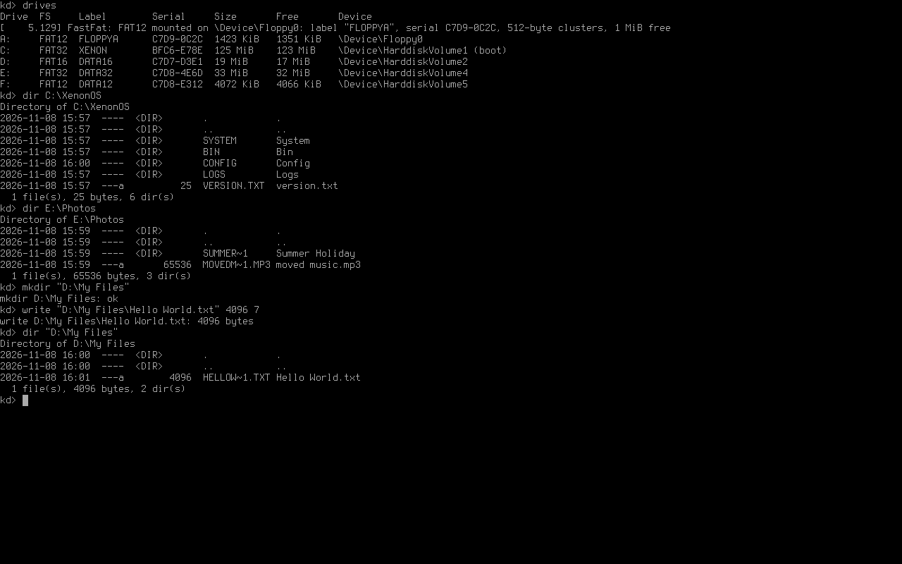

# XenonOS

An OS that's a mix of Linux and Windows (warning: fully vibe-coded, use at your own risk).

A from-scratch x86-64 operating system with a Windows NT-style kernel, native
FAT12/16/32 drive letters (A:–Z:), and a smart POSIX-style shell.

**Current version:** `XenonOS 0.0.1`, Milestone 1, **Phase 1.4 (FAT file system and drive letters) complete**.
See [PLAN.md](PLAN.md) for the full Milestone 1 plan.



## What works so far

### Phase 1.4: FAT file system and drive letters

- **FAT12, FAT16 and FAT32, read and write:**
  - long file names (Unicode, stored as UTF-16), with Windows-style 8.3 aliases (`HELLOW~1.TXT`) and the NT
    lowercase flags for plain 8.3 names;
  - mirrored FATs, FSInfo, timestamps, attributes, and the dirty flag (cleared when a volume is dismounted
    cleanly, and on removable media whenever nothing is open);
  - names are case-insensitive and case-preserving. 8.3 names written by other systems are read as code page 437.
- **A portable FAT core** (`drivers/fs/fatcore.c`) that also builds as a Linux program (`build/host/xfat`) for testing.
- **FastFat driver and NT-style file I/O:**
  - file objects, volume parameter blocks, mounting through `IRP_MN_MOUNT_VOLUME`;
  - path lookup that continues from `\GLOBAL??\C:` into the file system;
  - `NtCreateFile` with all NT dispositions, read/write/append, query/set information (size, attributes, times,
    rename, delete-on-close), directory listing with wildcards, volume information.
- **Removable media:** a swapped floppy is detected and remounted, and nothing is ever written to the newly
  inserted disk.
- **Drive letters (Mount Manager):**
  - **A:/B:** floppy drives;
  - **C:** the boot volume, identified from what the bootloader reports;
  - **D: onwards:** FAT primary partitions of all disks, then logical partitions, then removable volumes.
  - Volumes without FAT get no letter. Letters are **sticky**: `C:\XenonOS\Config\mountmgr.cfg` remembers them,
    so adding a disk does not shift existing letters.
- **Debug-shell commands** (until the real shell in Phase 1.5): `drives`, `dir`, `type`, `fcrc`, `mkdir`, `del`, `ren`,
  `copy`, `write`, `attrib`, `mount`, `umount`.

### Phase 1.3: storage

### Phase 1.3: storage

- **I/O Manager** as on Windows NT: driver objects (`\Driver\atapi`, `\Driver\storahci`, `\Driver\fdc`,
  `\Driver\disk`, `\Driver\partmgr`), device objects, and IRPs that travel down a stack of devices with
  per-driver stack locations and completion routines. The standard disk IOCTLs are supported.
- **IDE/ATA:** PCI controllers in legacy or native mode (and bare ISA ports), master and slave on each
  channel, LBA28 and LBA48 (disks larger than 128 GiB), **bus-master DMA** with fall-back to 32-bit PIO.
  CD/DVD (ATAPI) drives are recognised but not driven yet.
- **SATA/AHCI:** BIOS hand-off, DMA with physical region tables built from the buffer's pages (bounce buffer
  when needed), 64-bit addressing, and **MSI** completion interrupts (polling if a controller has no MSI).
- **Floppy (82077AA):** drives A: and B: from the CMOS, IRQ 6 and ISA DMA, motor control, 1.44 MB, 2.88 MB
  and 720 KB media (data rate probed, geometry from the boot sector), disk-change detection, and retries.
- **Disk class:** `\Device\HarddiskN\DR0` with `\GLOBAL??\PhysicalDriveN`, and `\Device\FloppyN` with `\GLOBAL??\FloppyN`.
- **Partition manager:** MBR including extended/logical partitions, GPT (CRC-checked, with fall-back to the
  backup header), and "superfloppy" disks (FAT with no partition table). Each partition becomes
  `\Device\HarddiskVolumeK`, reachable as `\Device\HarddiskN\PartitionM` and `\GLOBAL??\HarddiskVolumeK`.
- **Block cache:** 4 KiB lines with LRU, shared by raw and partition access so both always agree.
  Write-back with a 1-second lazy writer for fixed disks, write-through for removable media. Batched reads and
  writes, direct I/O for large transfers, and a flush on `exit`/`reboot`.
- **Debug-shell commands:** `disks`, `volumes`, `hexdump`, `crc32`, `writetest`, `cache`, `sync`.

Drive letters (A:, B:, C:, ...) and the FAT file system come in Phase 1.4.

### Phase 1.2: kernel core

### Phase 1.2: kernel core

- **IRQL** as on Windows NT (PASSIVE, APC, DISPATCH, device levels, CLOCK, HIGH), kept in the CPU's CR8
  register. Interrupt handlers run at their own level and can be interrupted by higher ones.
- **DPCs** (deferred procedure calls): interrupt handlers queue work that runs at DISPATCH_LEVEL once the
  interrupt is over.
- **Threads and a preemptive scheduler:** 32 priority levels, 20 ms time slices with round-robin within a
  level, immediate preemption when a higher-priority thread becomes ready, and an idle thread that halts the
  CPU. Exited threads are cleaned up, and their kernel stack slots are reused.
- **Dispatcher objects and waits:** events (notification and synchronization), mutexes (recursive, and
  "abandoned" when the owner exits), semaphores, timers (one-shot and periodic, with DPCs), and thread
  objects. Waits can be for any or all of up to 64 objects, with timeouts.
- **Object Manager:** reference-counted objects with types, a namespace (`\`, `\ObjectTypes`, `\Device`,
  `\Driver`, `\GLOBAL??`, `\DosDevices` → `\GLOBAL??`, `\BaseNamedObjects`, ...), symbolic links,
  case-insensitive lookup, and per-process handle tables.
- **Processes:** Idle (PID 0) and System (PID 4), which owns all kernel threads. User processes come in Phase 1.5.
- **Kernel log buffer** (128 KiB) holding every log line, for `dmesg`.
- **Kernel debug shell** (`kd>`) on the screen with the PS/2 keyboard, or on COM1. Commands: `objdir`,
  `threads`, `ps`, `mem`, `dmesg`, `uptime`, `date`, `irq`, `pci`, `threadtest`, `sleep`, `clear`, `crash`,
  `reboot`. It is a developer tool; the real `C:/#` shell comes in Phase 1.5.

### Phase 1.1: memory and platform

### Phase 1.1: memory and platform

- **Memory manager:** a physical page allocator that can limit allocations to below 16 MiB (for floppy DMA)
  or below 4 GiB (for older USB controllers), and that takes back the bootloader's memory after boot.
  The kernel builds its own 4-level page tables: all RAM is mapped with 2 MiB pages, kernel code is read-only,
  data is no-execute, the framebuffer is write-combining, and kernel stacks have guard pages.
- **Kernel pool:** NT-style `ExAllocatePoolWithTag` / `ExFreePoolWithTag` with per-tag accounting. Double frees,
  overwritten headers and writes after free stop the system with `BAD_POOL_CALLER` / `BAD_POOL_HEADER`.
- **ACPI tables:** RSDP, RSDT/XSDT, MADT (CPUs, IOAPICs, IRQ overrides), FADT, HPET and MCFG.
- **Interrupts:** local APIC (xAPIC, or x2APIC if the firmware enabled it) and IOAPIC routing with the ACPI
  overrides. The 8259 PIC stays masked.
- **Clocks:** the TSC is measured against the HPET, the ACPI PM timer or the PIT (best available), and the
  APIC timer drives a 1000 Hz system tick.
- **CMOS real-time clock:** read and write, BCD/binary and 12/24-hour formats, the ACPI century register,
  date conversions, and the CMOS floppy drive types.
- **PCI/PCIe enumeration:** through ECAM or the legacy ports, following bridges, with BAR sizing and the
  MSI/MSI-X/PCIe capabilities found. Each device is logged with its vendor and class.
- **Self-tests** (`xenon.selftest`): physical allocator, page tables, a 40,000-operation pool stress test,
  clock accuracy, IOAPIC interrupt routing, date maths, RTC and PCI.

### Phase 1.0: bring-up

- Boots with **Limine** from BIOS and UEFI off one FAT32 C: partition, from IDE or AHCI/SATA disks.
- Higher-half 64-bit kernel (`C:/XenonOS/System/xnkrnl.elf`) with its own GDT, TSS (separate stacks for
  double faults, NMIs and machine checks) and IDT.
- Framebuffer text console with the Terminus font. It switches to 16×32 glyphs on screens of 2560×1440 or larger,
  and supports UTF-8 and ANSI colour/cursor escape codes.
- Serial console on COM1 (115200 8N1) mirroring all output.
- Kernel log with timestamps from the TSC, which is calibrated against the PIT.
- An NT-style **stop screen** with the stop code, parameters, registers and a stack trace.
  The stop codes and exception codes use Windows NT numbers (`0x50 PAGE_FAULT_IN_NONPAGED_AREA`,
  `0x1E KMODE_EXCEPTION_NOT_HANDLED` with `0xC0000005`, and so on).
- The build number goes up by one on every `make image`.

After booting, the kernel debug shell (`kd>`) starts. The user shell (`C:/#` prompt) arrives in Phase 1.5.

## Building

Requirements (Debian/Ubuntu package names): `gcc`, `binutils`, `nasm`, `make`, `git`, `python3`,
`mtools`, `dosfstools`, `fdisk`, and for running: `qemu-system-x86`, `ovmf`.

```bash
make image
```

This downloads Limine on first use, increments `BUILD_NUMBER`, builds the kernel, and writes
`build/xenonos.img`, a 128 MiB MBR disk image with a bootable FAT32 C: partition.

| Command | What it does |
|---|---|
| `make image` (or just `make`) | New build: bump the build number, build the kernel and the disk image |
| `make kernel` | Build the kernel only, without changing the build number |
| `make run` | Boot the image in QEMU with BIOS (screen in a window, serial in the terminal) |
| `make run-uefi` | Boot with UEFI firmware (OVMF) on a q35 machine with AHCI |
| `make test` | Run the automated tests against the current image (does not bump the build number) |
| `make host` / `make host-test` | Build / test the FAT core as a Linux program (with AddressSanitizer) |
| `make clean` | Delete `build/` |

To write the image to a USB stick or disk for real hardware (this **erases** the target device):

```bash
sudo dd if=build/xenonos.img of=/dev/sdX bs=4M conv=fsync status=progress
```

## Build numbers

`BUILD_NUMBER` holds the number of the most recent image build. Each `make image` increments it, so the
system reports `XenonOS 0.0.1 (build 1)`, then `(build 2)`, and so on. The number appears in the boot
menu, the boot banner and the stop screen. Commit `BUILD_NUMBER` along with your changes.

## Kernel command line options

These are set on the `cmdline:` line in `C:/boot/limine/limine.conf`:

| Option | Effect |
|---|---|
| `xenon.debugexit` | Exit QEMU through the `isa-debug-exit` device instead of halting (used by the tests) |
| `xenon.selftest` | Run the kernel self-tests after boot |
| `xenon.interactive` | Together with `xenon.debugexit`: start the debug shell instead of exiting (used by `tools/qemu-session.py`) |
| `xenon.crash=KIND` | Crash on purpose to test the stop screen. `KIND` is one of `pagefault`, `divide`, `opcode`, `gpf`, `manual`, `assert`, `stackoverflow`, `doublefree`, `writecode` |

To turn an address from a stop screen into a function name and source line:

```bash
tools/symbolize.sh 0xffffffff80003361
```

## Tests

`make test` (41 checks) does the following:

- Checks the build-number counter and checks the disk image with `fsck.fat`.
- Boots with the kernel self-tests (18 tests) in eight QEMU configurations: BIOS + IDE (legacy PCI ports),
  BIOS + AHCI (PCIe ECAM), UEFI, 4 CPUs, 5 GiB RAM, 48 MiB RAM, no HPET (falls back to the ACPI PM timer),
  and all four USB controller types plus two network cards.
- Drives the debug shell, typing over COM1 and over the emulated PS/2 keyboard (on BIOS and UEFI).
- Runs the storage tests (`tools/test-storage.py`), which check raw sector reads and writes on IDE, SATA and
  floppy images against the host.
- Runs the FAT core host tests (`tools/test-fat-host.py`, also `make host-test`):
  - 18,000 random operations on FAT12/16/32, checked against an in-memory model with remounts along the way;
  - `fsck.fat -n` on every result;
  - an exact comparison with `mtools` in both directions.
- Runs the FAT and drive-letter tests in QEMU (`tools/test-fat.py`):
  - drive letters on a disk with FAT16, non-FAT, FAT32 and FAT12 partitions plus a floppy;
  - files written by `mtools` read back, then writes, appends, copies, renames, deletes, attributes, the expected
    errors, and a floppy swap;
  - afterwards `fsck.fat` must find every volume clean and `mtools` must see every change exactly;
  - a second boot checks persistence and sticky letters, and a third boot covers a GPT disk on SATA.
- Triggers nine kinds of crash to check the stop screen.

The self-tests cover the memory manager and pool, clocks, interrupt routing, the RTC, PCI, IRQL and DPCs,
events, mutexes, semaphores, timers, wait-any/all, preemption, round-robin time slicing, the object namespace,
and a 2 × 100-thread stress test that must give back every page and pool allocation.

`tools/qemu-session.py` can drive the debug shell by hand too:

```bash
tools/qemu-session.py "objdir \\" "threads" "exit"
```

## Source layout

```
kernel/arch/x86_64   GDT, TSS, IDT, interrupt entry stubs, stack switch
kernel/hal           ACPI, APIC/IOAPIC, HPET, clocks, CMOS RTC, PCI, serial port, PIC, reboot
kernel/ke            stop screen, IRQL, DPCs, scheduler, waits, events/mutexes/semaphores/timers
kernel/ob            object manager: objects, namespace, symbolic links, handles
kernel/ps            processes and threads
kernel/ex            kernel log buffer
kernel/io            I/O manager, files and mounting, mount manager, disk class, partitions, block cache
kernel/kd            kernel debug shell and its keyboard/serial input
drivers/storage      IDE/ATA, AHCI and floppy drivers
drivers/fs           FAT core (portable) and the FastFat file system driver
tests/host           host builds of kernel code (xfat)
kernel/mm            physical pages, page tables, kernel pool
kernel/con           framebuffer console, console multiplexer, kernel log
kernel/rtl           string and printf routines
kernel/font          built-in fonts (generated by tools/psf2c.py)
kernel/init          kernel entry point and boot sequence
kernel/test          kernel self-tests
tools/               build, image, QEMU, test (incl. test-storage.py), session and screenshot scripts
third_party/         Terminus font sources and license; Limine (downloaded)
```

## License

XenonOS is released under the [MIT License](LICENSE), Copyright (c) 2026 XenonOS Project.
Each source file carries an `SPDX-License-Identifier` line.

Third-party parts keep their own licenses:

- **Limine** bootloader (BSD-2-Clause), downloaded by `tools/fetch-limine.sh`. `kernel/include/limine.h` is
  copied from it (0BSD).
- **Terminus Font** by Dimitar Toshkov Zhekov (SIL Open Font License 1.1), embedded as the console font.
  See `third_party/fonts/terminus/LICENSE`.
