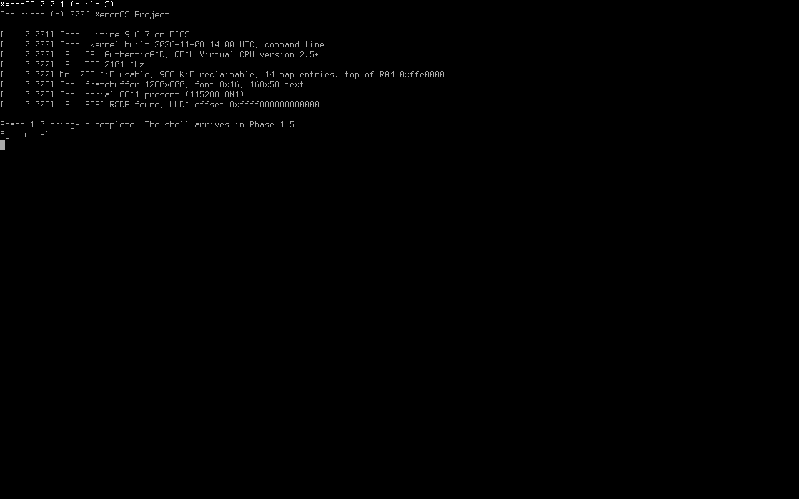

# XenonOS

A from-scratch x86-64 operating system with a Windows NT-style kernel, native
FAT12/16/32 drive letters (A:–Z:), and a smart POSIX-style shell.

**Current version:** `XenonOS 0.0.1`, Milestone 1, **Phase 1.0 (bring-up) complete**.
See [PLAN.md](PLAN.md) for the full Milestone 1 plan.



## What works so far (Phase 1.0)

- Boots with **Limine** from BIOS and UEFI off one FAT32 C: partition, from IDE or AHCI/SATA disks.
- Higher-half 64-bit kernel (`C:/XenonOS/System/xnkrnl.elf`) with its own GDT, TSS (separate stacks for
  double faults, NMIs and machine checks) and IDT.
- Framebuffer text console with the Terminus font. It switches to 16×32 glyphs on screens of 2560×1440 or larger,
  and supports UTF-8 and ANSI colour/cursor escape codes.
- Serial console on COM1 (115200 8N1) mirroring all output.
- Kernel log with timestamps from the TSC, which is calibrated against the PIT.
- An NT-style **stop screen** with the stop code, parameters, registers and a stack trace.
  The stop codes and exception codes use Windows NT numbers (`0x50 PAGE_FAULT_IN_NONPAGED_AREA`,
  `0x1E KMODE_EXCEPTION_NOT_HANDLED` with `0xC0000005`, and so on).
- The build number goes up by one on every `make image`.

The system halts after the boot summary. The shell (`C:/#` prompt) arrives in Phase 1.5.

## Building

Requirements (Debian/Ubuntu package names): `gcc`, `binutils`, `nasm`, `make`, `git`, `python3`,
`mtools`, `dosfstools`, `fdisk`, and for running: `qemu-system-x86`, `ovmf`.

```bash
make image
```

This downloads Limine on first use, increments `BUILD_NUMBER`, builds the kernel, and writes
`build/xenonos.img`, a 128 MiB MBR disk image with a bootable FAT32 C: partition.

| Command | What it does |
|---|---|
| `make image` (or just `make`) | New build: bump the build number, build the kernel and the disk image |
| `make kernel` | Build the kernel only, without changing the build number |
| `make run` | Boot the image in QEMU with BIOS (screen in a window, serial in the terminal) |
| `make run-uefi` | Boot with UEFI firmware (OVMF) on a q35 machine with AHCI |
| `make test` | Run the automated tests against the current image (does not bump the build number) |
| `make clean` | Delete `build/` |

To write the image to a USB stick or disk for real hardware (this **erases** the target device):

```bash
sudo dd if=build/xenonos.img of=/dev/sdX bs=4M conv=fsync status=progress
```

## Build numbers

`BUILD_NUMBER` holds the number of the most recent image build. Each `make image` increments it, so the
system reports `XenonOS 0.0.1 (build 1)`, then `(build 2)`, and so on. The number appears in the boot
menu, the boot banner and the stop screen. Commit `BUILD_NUMBER` along with your changes.

## Kernel command line options

These are set on the `cmdline:` line in `C:/boot/limine/limine.conf`:

| Option | Effect |
|---|---|
| `xenon.debugexit` | Exit QEMU through the `isa-debug-exit` device instead of halting (used by the tests) |
| `xenon.crash=KIND` | Crash on purpose to test the stop screen. `KIND` is one of `pagefault`, `divide`, `opcode`, `gpf`, `manual`, `assert` |

To turn an address from a stop screen into a function name and source line:

```bash
tools/symbolize.sh 0xffffffff80003361
```

## Tests

`make test` checks the build-number counter, checks the disk image with `fsck.fat`, boots in three
configurations (BIOS + IDE, BIOS + AHCI, UEFI + AHCI), and triggers six kinds of crash to check the stop screen.

## Source layout

```
kernel/arch/x86_64   GDT, TSS, IDT, interrupt entry stubs
kernel/hal           serial port, PIC, TSC timer, reboot
kernel/ke            bugcheck (stop screen)
kernel/con           framebuffer console, console multiplexer, kernel log
kernel/rtl           string and printf routines
kernel/font          built-in fonts (generated by tools/psf2c.py)
kernel/init          kernel entry point
tools/               build, image, QEMU, test and screenshot scripts
third_party/         Terminus font sources and license; Limine (downloaded)
```

## Licenses of third-party parts

- **Limine** bootloader (BSD-2-Clause), downloaded by `tools/fetch-limine.sh`. `kernel/include/limine.h` is
  copied from it (0BSD).
- **Terminus Font** by Dimitar Toshkov Zhekov (SIL Open Font License 1.1), embedded as the console font.
  See `third_party/fonts/terminus/LICENSE`.
